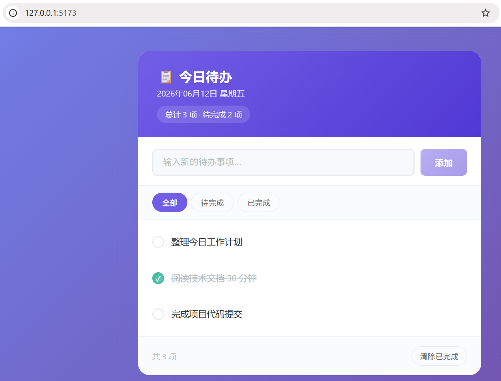

# Deep-Demo

**Turn a one-line requirement into a running React prototype — with E2E tests that prove it works.**

Deep-Demo is a multi-agent prototyping system built on DeepSeek. It writes a Vite + React +
TypeScript app, generates Playwright tests, runs them, diagnoses failures, reviews the result,
and leaves you with a live preview URL.

English · [简体中文](README.zh-CN.md)

> Early commits were written with [opencode](https://opencode.ai) + DeepSeek. Recent work — the
> stage machine, the report contract and the roadmap — was built with
> [DeepSeek Harness](https://www.deepseek.com/en/harness/).

---

## Quick start

Node.js 20+ and a DeepSeek API key are all you need.

```bash
npm install
cp .env.example .env                     # then set LLM_API_KEY
echo "a simple dashboard" > requirements.md
npx tsx src/index.ts --requirements requirements.md
```

The run ends in one of three states:

| Exit code | Stage | What to do |
|---|---|---|
| `0` | `done` | Open the preview URL printed in the log |
| `1` | `failed` | Retries exhausted — read `workspace/reviews/` and `workspace/reports/` |
| `2` | `blocked` | Answer the question in `workspace/needs-human.md`, then re-run |

### CLI

| Flag | Description |
|---|---|
| `--requirements <path>` | Requirement file to build from (required) |
| `--verbose` | Print tool calls, arguments and timings |
| `WORKSPACE_DIR` | Output directory, defaults to `./workspace` |

---

## How it works

```
requirements.md
      │
      ▼
┌──────────────── Orchestrator ─────────────────┐
│  stage: queued → working → { done             │
│                            | blocked          │
│                            | failed }         │
│                                               │
│  Developer ──► npm install ──► Vite dev server│
│      │                              │         │
│      ▼                              ▼         │
│  Tester ──► Playwright tests ──► e2e tests    │
│      │                              │         │
│      ▼                              ▼         │
│  Reviewer ◄───────────── pass ──────┘         │
│      │                                        │
│      ├── ready          → done                │
│      ├── needs_changes  → next attempt        │
│      └── blocked        → a human must decide │
└───────────────────────────────────────────────┘
```

Every agent finishes by writing a machine-readable report. The orchestrator never parses prose:
it reads `status` and moves the stage machine. A failed round is retried with the previous
report's `feedback`, not by replaying the whole pipeline blindly.

## Stages and reports

Five stages live in [`src/stage.ts`](src/stage.ts), and every transition is logged:

```
queued → working → { done | blocked | failed }
```

Each agent writes `reports/<agent>.json` before it stops. The contract is defined once in
[`src/report.ts`](src/report.ts) (`reportContract()`) and appended to all three system prompts.

| `status` | Meaning | Pipeline action |
|---|---|---|
| `ready` | This round met its goal | Advance (Reviewer `ready` ⇒ `done`) |
| `needs_changes` | Usable, but with concrete problems | Feed `feedback` into the next round |
| `blocked` | Only a human can decide | Stop now, write `needs-human.md`, exit `2` |
| `failed` | Nothing usable came out | Retry, consuming one attempt |

Rules that keep this honest:

- **Fail closed.** A missing or unparseable report is `failed`, never a silent success.
- **No stale conclusions.** The previous round's report file is deleted before each run.
- **Legacy fallback is loud.** A markdown `## 结论` block is still understood, but logs a warning
  so you can spot a model that ignores the contract.
- **`blocked` does not burn retries.** It short-circuits the run on the spot instead of spending
  the remaining attempts on a decision the agent cannot make.

## Diagnostic retry

When E2E tests fail, an independent LLM diagnosis decides what to do next:

| Action | When | Effect |
|---|---|---|
| `retry_dev` | The code is wrong | Re-run Developer with the diagnosis as feedback |
| `retry_tester` | The test is wrong | Skip Developer, re-run Tester with the diagnosis |
| `blocked` | A human must decide | Stop the run and ask |

## Agents

| Agent | Thinking | Tools | Responsibility |
|---|---|---|---|
| Developer | `enabled` (medium) | `readFile`, `writeFile` | Build the 8-file React + Vite prototype |
| Tester | `disabled` | `readFile`, `writeFile` | Generate Playwright E2E tests |
| Reviewer | `enabled` (medium) | `readFile`, `writeFile`, `listFiles` | Review UX, code quality and test coverage |
| Orchestrator | `disabled` | context only | Diagnose test failures, decide retry or block |

Two deliberate constraints:

- **Tool isolation.** Developer and Tester get no `listFiles`, so they cannot waste steps probing
  empty directories. The Reviewer needs the full view and gets it.
- **KV cache.** All agents share the same system-prompt prefix, so the DeepSeek KV cache hits
  across agents; the report contract is appended after it.

## Configuration

| Variable | Default | Description |
|---|---|---|
| `LLM_API_KEY` | — | DeepSeek API key (required) |
| `LLM_BASE_URL` | `https://api.deepseek.com` | API endpoint |
| `LLM_MODEL` | `deepseek-v4-flash` | Model name |
| `WORKSPACE_DIR` | `./workspace` | Where the prototype and artifacts are written |

## Project layout

```
src/
├── index.ts              # CLI entry and exit codes
├── orchestrator.ts       # Stage machine driver, build/test/review loop
├── agents/
│   ├── base.ts           # Abstract agent, prompt assembly, report contract
│   ├── developer.ts      # Prototype builder
│   ├── tester.ts         # Playwright test generator
│   └── reviewer.ts       # UX / code / test reviewer
├── report.ts             # Report contract, zod validation, tolerant parsing
├── stage.ts              # Stage type and StageTracker
├── llm.ts                # OpenAI SDK wrapper: tool loop, timeout, retry, thinking
├── tools.ts              # Tool factories with path-traversal protection
├── logger.ts             # Structured console logger
└── types.ts              # Shared types
```

## Development

```bash
npm test           # watch mode
npm run test:run   # single run
npx tsc --noEmit   # typecheck
npm run build      # emit to dist/
```

## Example run

Output labels are bilingual by design; the stage name prints as `执行中 / working`.

```
  ⚛  Deep-Demo 多 Agent 协作开发系统

[12:24:07.012] [Orchestrator] Workspace directories created
[12:24:07.316] [Developer   ] Building prototype...
[12:24:51.313] [developer   ]   Step 1/10 (43994ms) → 8 writeFile calls
[12:24:56.700] [developer   ] 汇报(json): [ready] 8 个文件已生成
[12:25:05.811] [Orchestrator] Installing dependencies...
[12:26:03.430] [Orchestrator] Preview URL: http://localhost:5173/
[12:26:23.804] [Tester      ] Generating e2e tests...
[12:26:26.801] [Orchestrator] Tests failed (8/9 passed)
[12:26:29.010] [Orchestrator] Diagnosing test failure...
[12:26:29.318] [Orchestrator] Pipeline run (attempt 2/4)
...
[12:28:06.910] [reviewer    ] 汇报(json): [ready] 原型功能完整，交互流畅
[12:28:07.338] [Orchestrator] 阶段: 执行中 / working → 完成 / done
[12:28:07.338] [Orchestrator] Preview URL: http://localhost:5173/
```



## Roadmap

Persistence and `--resume`, per-task directory isolation, a worker slot pool, an outbox for
external side effects, and a human-in-the-loop `awaiting_review` stage. See
[docs/roadmap.md](docs/roadmap.md) (currently in Chinese) for acceptance criteria and non-goals.

## License

[MIT](LICENSE)
