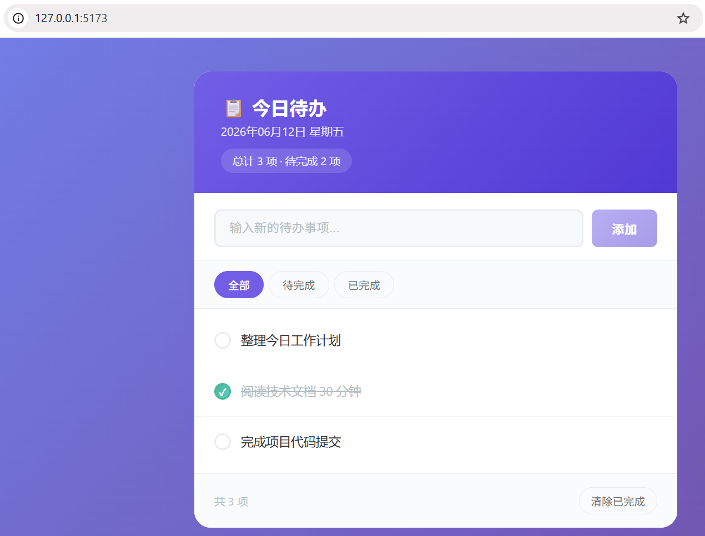

# Deep-Demo

**一句需求，换一个能跑起来的 React 原型 —— 还有证明它真能跑的 E2E 测试。**

Deep-Demo 是一个基于 DeepSeek 的多 Agent 原型开发系统。它会写出 Vite + React + TypeScript 应用，
生成 Playwright 测试并实际运行，诊断失败原因，评审结果，最后留下一个可访问的预览地址。

[English](README.md) · 简体中文

> 项目早期代码由 [opencode](https://opencode.ai) + DeepSeek 生成；后续的阶段机、汇报契约与路线图
> 由 [DeepSeek Harness](https://www.deepseek.com/en/harness/) 完成。

---

## 快速开始

只需要 Node.js 20+ 和一个 DeepSeek API Key。

```bash
npm install
cp .env.example .env                     # 填入 LLM_API_KEY
echo "a simple dashboard" > requirements.md
npx tsx src/index.ts --requirements requirements.md
```

运行会以三种状态之一结束：

| 退出码 | 阶段 | 接下来做什么 |
|---|---|---|
| `0` | `done` | 打开日志里的预览地址 |
| `1` | `failed` | 重试次数用尽，查看 `workspace/reviews/` 与 `workspace/reports/` |
| `2` | `blocked` | 回答 `workspace/needs-human.md` 里的问题后重跑 |

### 命令行参数

| 参数 | 说明 |
|---|---|
| `--requirements <path>` | 需求文件路径（必填） |
| `--verbose` | 打印工具调用、参数与耗时 |
| `WORKSPACE_DIR` | 输出目录，默认 `./workspace` |

---

## 工作方式

```
requirements.md
      │
      ▼
┌──────────────── Orchestrator ─────────────────┐
│  阶段: queued → working → { done              │
│                           | blocked           │
│                           | failed }          │
│                                               │
│  Developer ──► npm install ──► Vite 开发服务器│
│      │                              │         │
│      ▼                              ▼         │
│  Tester ──► Playwright 测试 ──► 运行 E2E 测试 │
│      │                              │         │
│      ▼                              ▼         │
│  Reviewer ◄───────────── 通过 ──────┘         │
│      │                                        │
│      ├── ready          → 完成                │
│      ├── needs_changes  → 进入下一轮          │
│      └── blocked        → 停下等人决定        │
└───────────────────────────────────────────────┘
```

每个 Agent 结束时都会写一份机器可读的汇报。Orchestrator 从不解析自然语言，只读 `status` 驱动
状态机；失败的一轮用上一份汇报里的 `feedback` 重试，而不是盲目重放整条流水线。

## 阶段与汇报

五个阶段定义在 [`src/stage.ts`](src/stage.ts)，每次迁移都会打日志：

```
queued → working → { done | blocked | failed }
```

每个 Agent 停下前写 `reports/<agent>.json`。契约只在
[`src/report.ts`](src/report.ts)（`reportContract()`）定义一次，拼进三个 Agent 的 system prompt。

| `status` | 含义 | 流水线动作 |
|---|---|---|
| `ready` | 本轮达标 | 进入下一阶段（Reviewer 报 `ready` 即 `done`） |
| `needs_changes` | 产物可用但有明确问题 | 把 `feedback` 落成下一轮输入 |
| `blocked` | 只有人能决定 | 立即终止，写 `needs-human.md`，退出码 `2` |
| `failed` | 本轮产不出可用结果 | 重试，消耗一次 attempt |

几条保证：

- **失败即失败（fail closed）**：汇报缺失或解析失败一律按 `failed` 处理，绝不默认成功。
- **不继承旧结论**：每轮开始前删除上一轮的汇报文件，避免旧结论污染新决策。
- **旧格式会告警**：仍认识 markdown 的 `## 结论`，但会打警告，便于发现没按契约输出的模型。
- **`blocked` 不烧重试**：当场短路，不把剩余次数浪费在 Agent 无法决定的事情上。

## 诊断重试

E2E 测试失败时，由一次独立的 LLM 诊断决定下一步：

| 动作 | 何时 | 效果 |
|---|---|---|
| `retry_dev` | 代码有问题 | 带上诊断结论重跑 Developer |
| `retry_tester` | 测试有问题 | 跳过 Developer，带上诊断结论重跑 Tester |
| `blocked` | 需要人决定 | 停止并提问 |

## Agent 分工

| Agent | Thinking | 工具 | 职责 |
|---|---|---|---|
| Developer | `enabled` (medium) | `readFile`、`writeFile` | 构建 8 个文件的 React + Vite 原型 |
| Tester | `disabled` | `readFile`、`writeFile` | 生成 Playwright E2E 测试 |
| Reviewer | `enabled` (medium) | `readFile`、`writeFile`、`listFiles` | 评审 UI/UX、代码质量与测试覆盖 |
| Orchestrator | `disabled` | 仅上下文 | 诊断测试失败，决定重试还是阻断 |

两个刻意的约束：

- **工具隔离**：Developer 和 Tester 拿不到 `listFiles`，避免在空目录上浪费步数；Reviewer 需要
  全局视角，所以给全量工具。
- **KV cache**：三个 Agent 共享同一段 system prompt 前缀，DeepSeek KV cache 可以跨 Agent 命中；
  汇报契约追加在前缀之后，不破坏共享。

## 配置

| 变量 | 默认值 | 说明 |
|---|---|---|
| `LLM_API_KEY` | — | DeepSeek API Key（必填） |
| `LLM_BASE_URL` | `https://api.deepseek.com` | API 地址 |
| `LLM_MODEL` | `deepseek-v4-flash` | 模型名 |
| `WORKSPACE_DIR` | `./workspace` | 原型与产物的输出目录 |

## 项目结构

```
src/
├── index.ts              # CLI 入口与退出码
├── orchestrator.ts       # 阶段机驱动、构建/测试/评审循环
├── agents/
│   ├── base.ts           # Agent 抽象基类、prompt 组装、汇报契约
│   ├── developer.ts      # 原型构建
│   ├── tester.ts         # Playwright 测试生成
│   └── reviewer.ts       # UI / 代码 / 测试评审
├── report.ts             # 汇报契约、zod 校验、容错解析
├── stage.ts              # 阶段类型与 StageTracker
├── llm.ts                # OpenAI SDK 封装：工具循环、超时、重试、thinking
├── tools.ts              # 工具工厂（含路径穿越防护）
├── logger.ts             # 结构化控制台日志
└── types.ts              # 共享类型
```

## 开发

```bash
npm test           # watch 模式
npm run test:run   # 单次运行
npx tsc --noEmit   # 类型检查
npm run build      # 输出到 dist/
```

## 运行示例

日志标签是中英混排的，阶段名会打印成 `执行中 / working`。

```
  ⚛  Deep-Demo 多 Agent 协作开发系统

[12:24:07.012] [Orchestrator] Workspace directories created
[12:24:07.316] [Developer   ] Building prototype...
[12:24:51.313] [developer   ]   Step 1/10 (43994ms) → 8 writeFile calls
[12:24:56.700] [developer   ] 汇报(json): [ready] 8 个文件已生成
[12:25:05.811] [Orchestrator] Installing dependencies...
[12:26:03.430] [Orchestrator] Preview URL: http://localhost:5173/
[12:26:23.804] [Tester      ] Generating e2e tests...
[12:26:26.801] [Orchestrator] Tests failed (8/9 passed)
[12:26:29.010] [Orchestrator] Diagnosing test failure...
[12:26:29.318] [Orchestrator] Pipeline run (attempt 2/4)
...
[12:28:06.910] [reviewer    ] 汇报(json): [ready] 原型功能完整，交互流畅
[12:28:07.338] [Orchestrator] 阶段: 执行中 / working → 完成 / done
[12:28:07.338] [Orchestrator] Preview URL: http://localhost:5173/
```



## 路线图

持久化与 `--resume`、任务目录隔离、并发槽位、外部动作的 outbox，以及 `awaiting_review`
的人机回路。验收标准与「明确不做」见 [docs/roadmap.md](docs/roadmap.md)。

## 许可证

[MIT](LICENSE)
